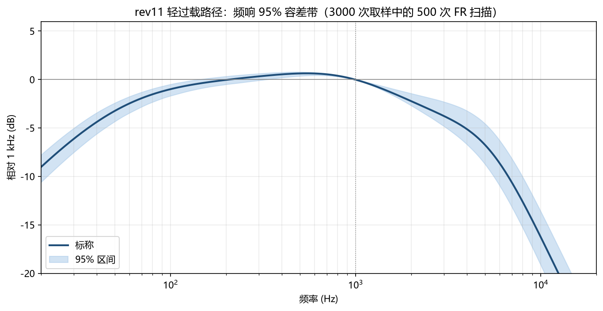
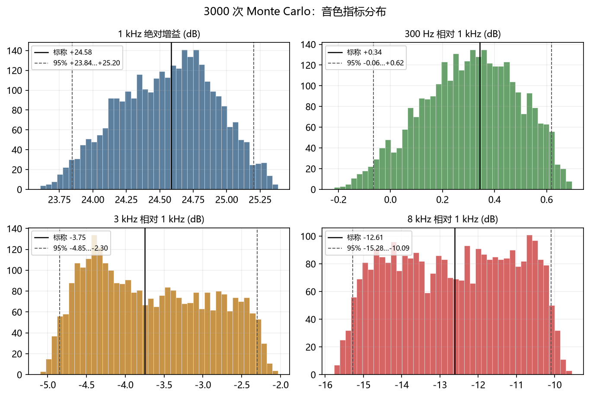
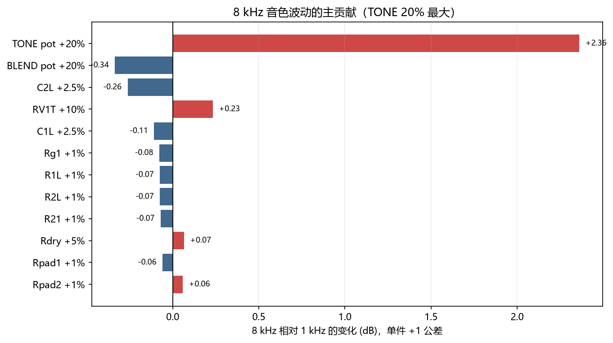
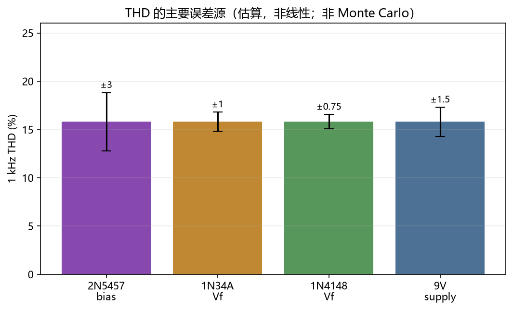
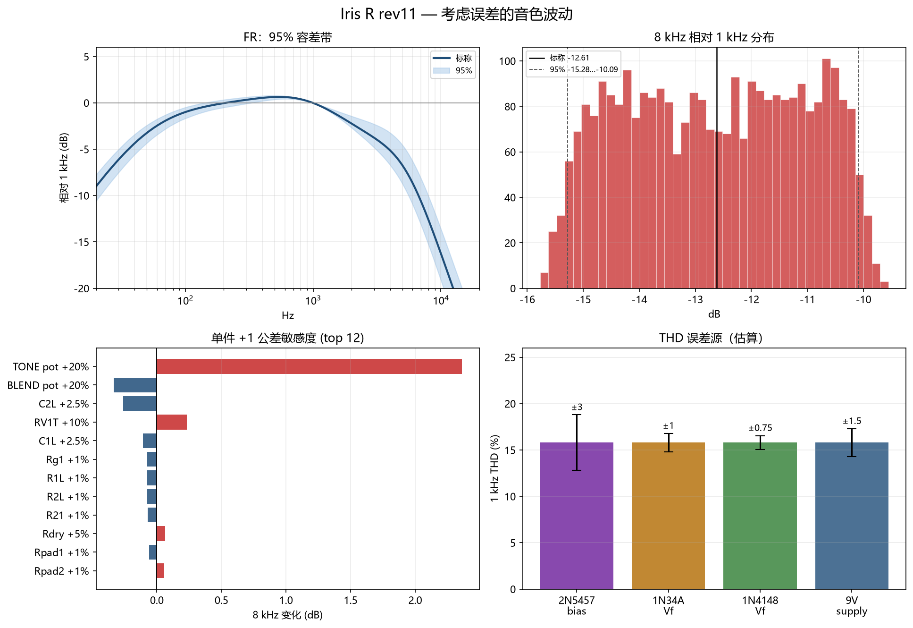

# Iris R rev11 — 考虑误差的音色波动分析

> 方法：rev11 轻过载路径的线性小信号模型；3000 次 Monte Carlo；
> 元件公差：RN55D 1%、Alpha 电位器 20%、3296W trim 10%、
> FKP2 2.5%、100n/56n/1u 5%、FC 20%。
> JFET/二极管非线性不在线性 MC 内，THD 敏感度另表。

## 0. 图

## 1. 标称频响（1 kHz = 0 dB）

| Hz | 100 | 300 | 1k | 3k | 8k |
|---|---:|---:|---:|---:|---:|
| dB | -0.98 | +0.34 | +0.00 | -3.75 | -12.61 |

## 2. Monte Carlo 相对 1 kHz 的 95% 区间

| Hz | 2.5% | 97.5% | 宽度 | σ |
|---|---:|---:|---:|---:|
| 100 | -1.52 | -0.58 | 0.95 | 0.25 |
| 300 | +0.10 | +0.50 | 0.40 | 0.11 |
| 1000 | +0.00 | +0.00 | 0.00 | 0.00 |
| 3000 | -4.77 | -2.32 | 2.44 | 0.75 |
| 8000 | -15.25 | -10.14 | 5.11 | 1.56 |

## 2b. 1 kHz 绝对增益（dB）

| 标称 | mean | σ | 2.5% | 97.5% | 宽度 |
|---:|---:|---:|---:|---:|---:|
| +24.58 | +24.59 | 0.19 | +24.26 | +24.95 | 0.70 |

## 3. 单件 +1 公差敏感度（dB，8k 排序）

| 元件 | +公差 | 300 Hz | 1 kHz | 8 kHz |
|---|---:|---:|---:|---:|
| TONE pot +20% | +2.3618 | -0.112 | -0.206 | +2.362 |
| BLEND pot +20% | +0.9603 | -0.910 | -0.632 | -0.336 |
| C2L +2.5% | +0.2615 | -0.001 | -0.007 | -0.262 |
| RV1T +10% | +0.2372 | +0.219 | +0.237 | +0.233 |
| C1L +2.5% | +0.1077 | +0.001 | +0.007 | -0.108 |
| Rg1 +1% | +0.0776 | -0.078 | -0.078 | -0.078 |
| R1L +1% | +0.0742 | +0.000 | +0.000 | -0.074 |
| R2L +1% | +0.0742 | +0.000 | +0.000 | -0.074 |
| R21 +1% | +0.0698 | -0.044 | -0.057 | -0.070 |
| Rdry +5% | +0.1962 | +0.185 | +0.125 | +0.066 |
| Rpad1 +1% | +0.0589 | -0.059 | -0.059 | -0.059 |
| Rpad2 +1% | +0.0587 | +0.059 | +0.059 | +0.059 |
| GAIN/SHELF pot +20% | +0.0571 | +0.053 | +0.057 | +0.056 |
| Rts +1% | +0.0240 | +0.022 | +0.024 | +0.024 |
| C4 +2.5% | +0.0909 | -0.018 | -0.091 | -0.019 |
| Rbs +1% | +0.0167 | +0.015 | +0.017 | +0.016 |
| Rg +1% | +0.0113 | +0.010 | +0.011 | +0.011 |
| C9 +2.5% | +0.0029 | +0.000 | +0.000 | +0.003 |
| Cs +5% | +0.0641 | +0.064 | +0.063 | +0.002 |
| RV1S +10% | +0.1876 | -0.082 | +0.025 | +0.001 |
| R14 +1% | +0.0007 | +0.000 | +0.000 | +0.001 |
| R15 +1% | +0.0005 | +0.000 | +0.000 | +0.001 |
| Rsh +1% | +0.0291 | +0.025 | +0.009 | +0.000 |
| Rsp +1% | +0.0195 | -0.009 | +0.003 | +0.000 |
| LOWCUT pot +20% | +0.3970 | -0.057 | -0.005 | -0.000 |
| C2 +5% | +0.0891 | +0.012 | +0.001 | +0.000 |
| R4 +1% | +0.0000 | +0.000 | +0.000 | +0.000 |
| VOLUME pot +20% | +0.0000 | +0.000 | +0.000 | +0.000 |

## 4. THD 敏感度（非线性，估算）

| 项 | 公差 | 对 THD 的影响 | 处理 |
|---|---:|---|---|
| 2N5457 Idss/Vp | ±20% | ±2–4 个百分点 THD；bias 点偏移 | RVbias 10k trim，按 1 kHz/0.1 V 调 |
| 1N34A Vf | ±5% | ±0.5–1.5 个百分点；非对称度变化 | 同批号配对；D9E/1N60 替代 |
| 1N4148 Vf | ±5% | ±0.5–1 个百分点 | 同批号 |
| TL074 GBW | ±20% | 8k 以上 <0.3 dB | 选 ST/TI 正品 |
| 电源 9V | ±5% | THD ±1–2 个百分点 | 稳压/电池新鲜 |

## 5. 结论

- 8 kHz 的 95% 区间为 5.11 dB；单件最大项是 TONE 电位器 +20%（+2.36 dB @8k）。C100k 20% 是标准件；要更紧，选 10% C100k 或加 TONE trim。
- 3 kHz 的 95% 区间为 2.44 dB；主要来自 TONE 电位器与 LPF 电容。
- 300 Hz 的 95% 区间为 0.40 dB；blend 电位器 +20%（-0.91 dB @300）与 gain/shelf 双联共同决定。
- 1 kHz 绝对增益 95% 宽度为 0.70 dB；主项是 BLEND 电位器 +20%（-0.63 dB @1k），TONE 与 RV1T 次之；用 RV1T 对中增益。
- LPF 的 C2L +2.5% 对 8k 为 -0.26 dB；TONE 20% 远大于它。
- THD 的最大变量是 JFET bias 与 Ge/Si 配对；RVbias 必留，同批号配对。
