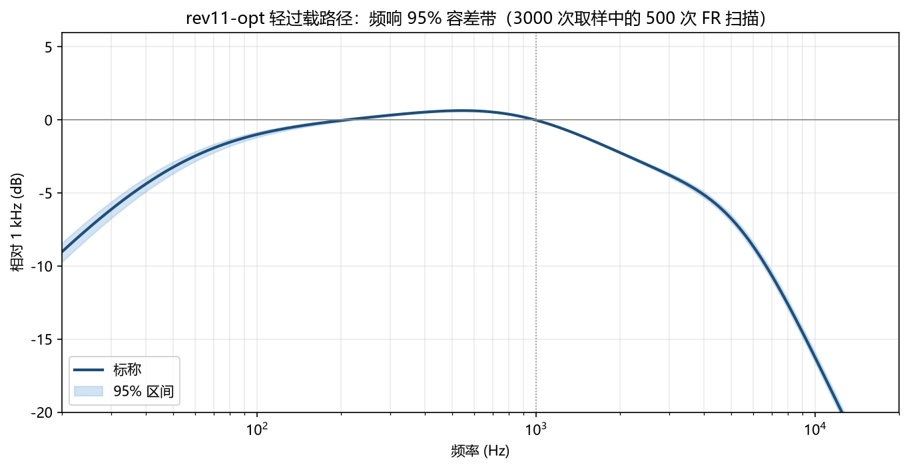
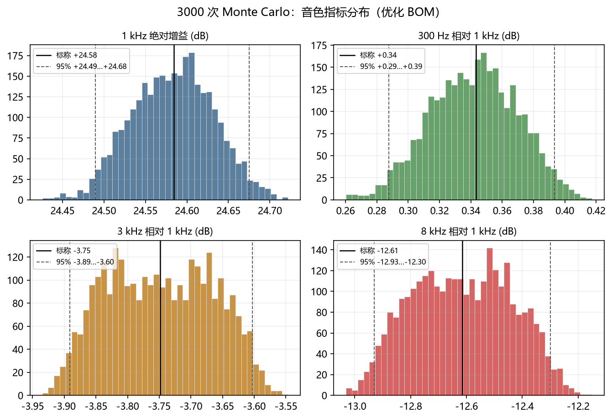
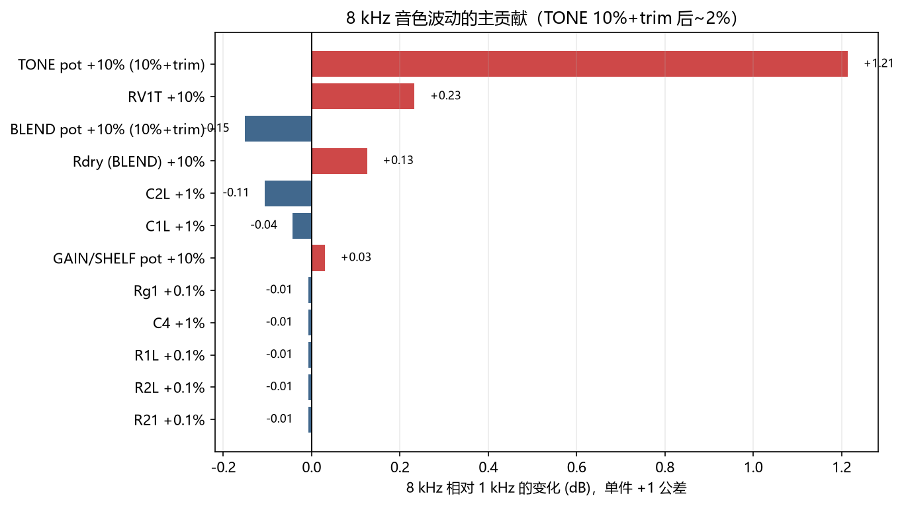
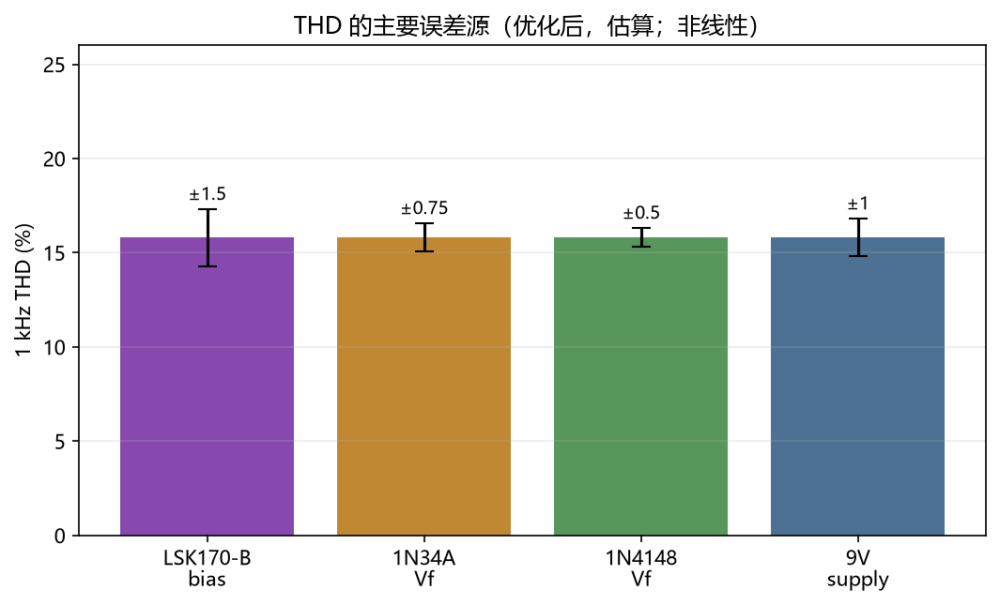
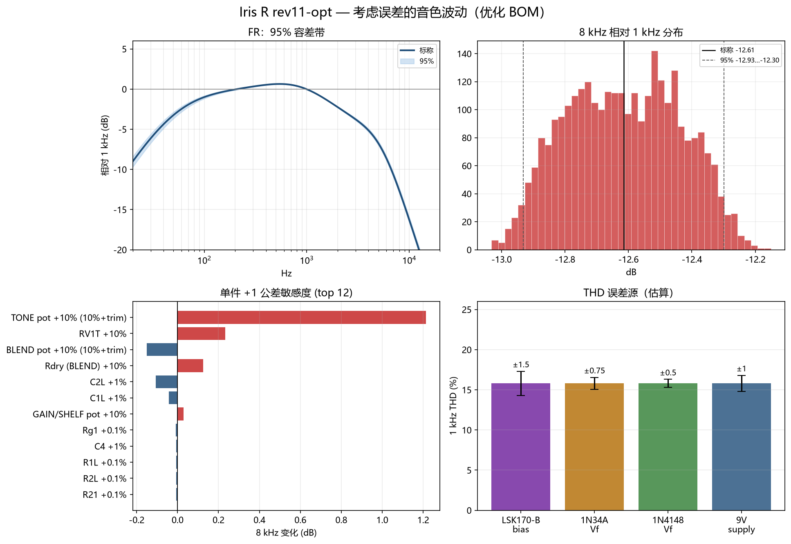

# Iris R rev11-opt — 考虑误差的音色波动分析（优化 BOM）

> 方法：rev11 轻过载路径的线性小信号模型；3000 次 Monte Carlo；
> 元件公差：RN55E 0.1%、Bourns PTV 10%（TONE/BLEND 加 RV3T/RV5T 后 ~2%）、
> 3296W trim 10%、FKP2 1%、56n/1u 2.5%、FC 10% 精选。
> JFET/二极管非线性不在线性 MC 内，THD 敏感度另表。

## 0. 图

## 1. 标称频响（1 kHz = 0 dB）

| Hz | 100 | 300 | 1k | 3k | 8k |
|---|---:|---:|---:|---:|---:|
| dB | -0.98 | +0.34 | +0.00 | -3.75 | -12.61 |

## 2. Monte Carlo 相对 1 kHz 的 95% 区间

| Hz | 2.5% | 97.5% | 宽度 | σ |
|---|---:|---:|---:|---:|
| 100 | -1.18 | -0.81 | 0.36 | 0.10 |
| 300 | +0.29 | +0.39 | 0.11 | 0.03 |
| 1000 | +0.00 | +0.00 | 0.00 | 0.00 |
| 3000 | -3.89 | -3.60 | 0.29 | 0.08 |
| 8000 | -12.93 | -12.30 | 0.63 | 0.18 |

## 2b. 1 kHz 绝对增益（dB）

| 标称 | mean | σ | 2.5% | 97.5% | 宽度 |
|---:|---:|---:|---:|---:|---:|
| +24.58 | +24.58 | 0.05 | +24.49 | +24.68 | 0.19 |

## 3. 单件 +1 公差敏感度（dB，8k 排序）

| 元件 | +公差 | 300 Hz | 1 kHz | 8 kHz |
|---|---:|---:|---:|---:|
| TONE pot +10% (10%+trim) | +1.2141 | -0.051 | -0.127 | +1.214 |
| RV1T +10% | +0.2372 | +0.219 | +0.237 | +0.233 |
| BLEND pot +10% (10%+trim) | +0.4406 | -0.416 | -0.286 | -0.151 |
| Rdry (BLEND) +10% | +0.3787 | +0.356 | +0.239 | +0.126 |
| C2L +1% | +0.1055 | -0.000 | -0.003 | -0.105 |
| C1L +1% | +0.0428 | +0.000 | +0.003 | -0.043 |
| GAIN/SHELF pot +10% | +0.0308 | +0.028 | +0.031 | +0.030 |
| Rg1 +0.1% | +0.0078 | -0.008 | -0.008 | -0.008 |
| C4 +1% | +0.0364 | -0.007 | -0.036 | -0.008 |
| R1L +0.1% | +0.0074 | +0.000 | +0.000 | -0.007 |
| R2L +0.1% | +0.0074 | +0.000 | +0.000 | -0.007 |
| R21 +0.1% | +0.0070 | -0.004 | -0.006 | -0.007 |
| Rpad1 +0.1% | +0.0059 | -0.006 | -0.006 | -0.006 |
| Rpad2 +0.1% | +0.0059 | +0.006 | +0.006 | +0.006 |
| Rts +0.1% | +0.0024 | +0.002 | +0.002 | +0.002 |
| Rbs +0.1% | +0.0017 | +0.002 | +0.002 | +0.002 |
| C9 +1% | +0.0011 | +0.000 | +0.000 | +0.001 |
| Rg +0.1% | +0.0011 | +0.001 | +0.001 | +0.001 |
| Cs +2.5% | +0.0322 | +0.032 | +0.032 | +0.001 |
| RV1S +10% | +0.1876 | -0.082 | +0.025 | +0.001 |
| R14 +0.1% | +0.0001 | +0.000 | +0.000 | +0.000 |
| R15 +0.1% | +0.0000 | +0.000 | +0.000 | +0.000 |
| Rsp +0.1% | +0.0020 | -0.001 | +0.000 | +0.000 |
| Rsh +0.1% | +0.0029 | +0.003 | +0.001 | +0.000 |
| C2 +1% | +0.0187 | +0.003 | +0.000 | +0.000 |
| R4 +0.1% | +0.0000 | +0.000 | +0.000 | +0.000 |
| LOWCUT pot +10% | +0.1761 | -0.025 | -0.002 | -0.000 |
| VOLUME pot +10% | +0.0000 | +0.000 | +0.000 | +0.000 |

## 4. THD 敏感度（非线性，估算）

| 项 | 公差 | 对 THD 的影响 | 处理 |
|---|---:|---|---|
| LSK170-B Idss/Vp | 分档 | ±1–2 个百分点 THD；bias 点偏移 | RVbias 10k trim，按 1 kHz/0.1 V 调 |
| 1N34A Vf | ±5% | ±0.5–1 个百分点；非对称度变化 | 同批号配对；D9E/1N60 替代 |
| 1N4148 Vf | ±5% | ±0.3–0.75 个百分点 | 同批号配对 |
| OPA4134 GBW | ±20% | 8k 以上 <0.2 dB | 选正品；TL074 可替代 |
| 电源 9V | ±5% | THD ±0.5–1 个百分点 | 稳压/低噪适配器；MAX1044 |

## 5. 结论

- 8 kHz 的 95% 区间为 0.63 dB；主项仍是 TONE（10% + RV3T 后按 ~2% 计，单件 +1.21 dB @8k）。20% 原版约 5.1 dB，10% 约 2.6 dB，10%+trim 目标 <1.5 dB。
- 3 kHz 的 95% 区间为 0.29 dB；TONE 与 LPF 1% 电容共同决定。
- 300 Hz 的 95% 区间为 0.11 dB；BLEND 10%+RV5T（-0.42 dB @300）与 gain/shelf 10% 双联共同决定。
- 1 kHz 绝对增益 95% 宽度为 0.19 dB；主项是 BLEND 10%+RV5T（-0.29 dB @1k），TONE 与 RV1T 次之。
- LPF 的 C2L 1% 对 8k 为 -0.11 dB；已从 2.5% 的约 -0.26 降到约 -0.10。
- THD 的最大变量仍是 JFET/Ge/Si 与 9V；LSK170-B、配对、RVbias、稳压电源比换电容更重要。
